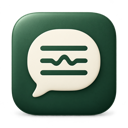
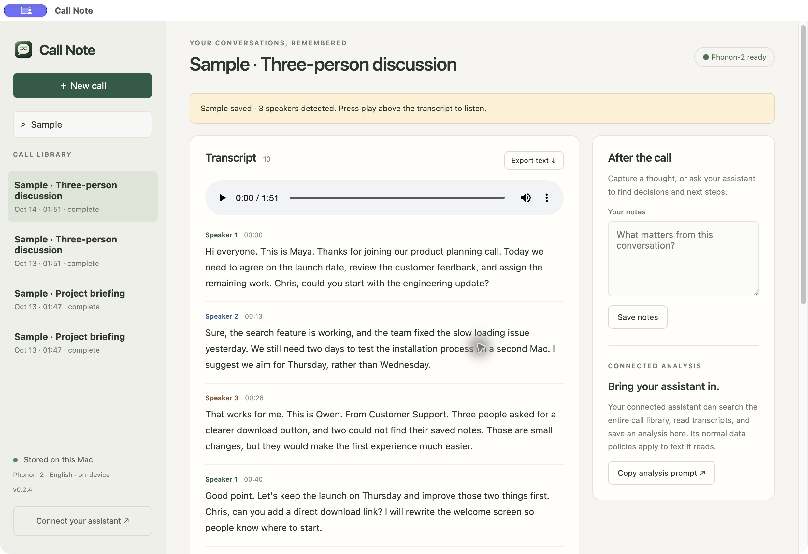
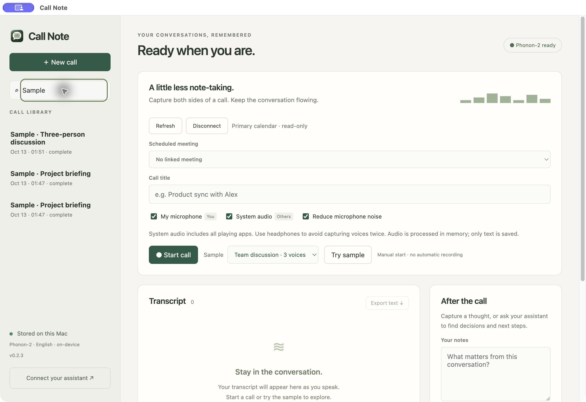
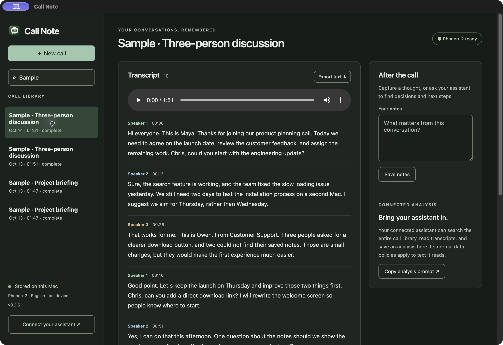
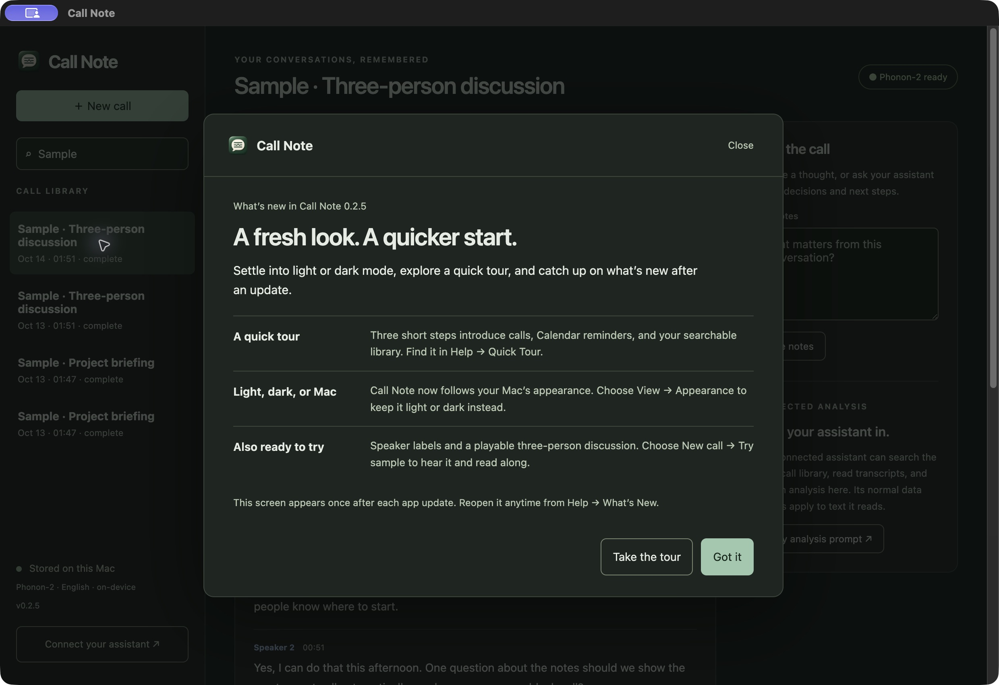

# Call Note

**Stay in the conversation. Keep the transcript.**

Call Note transcribes both sides of your calls on your Mac. Find past conversations, add notes, and ask Codex or Claude to pull out decisions and next steps.

*A saved sample conversation. Transcription and your call library stay on your Mac.*

### [Download v0.2.8 for Mac →](https://github.com/slyapustin/call-note/releases/download/v0.2.8/Call-Note-0.2.8-macOS-arm64.dmg)

Newest downloadable build · [Release notes](https://github.com/slyapustin/call-note/releases/tag/v0.2.8)

**Apple Silicon (M1 or newer) · macOS 14.2+ · English speech**

[Windows 11 x64 preview (.exe)](https://github.com/slyapustin/call-note/releases/download/v0.2.8-windows-preview/Call-Note-0.2.8-Windows-x64.exe) · Unsigned preview, manual updates. [Requirements and testing status](https://github.com/slyapustin/call-note/releases/tag/v0.2.8-windows-preview).

> [!NOTE]
> **Signed and notarized.** Call Note v0.2.8 and its Mac installer are signed with Apple Developer ID, notarized by Apple, and verified with macOS Gatekeeper.

## Get started

1. Download Call Note using the link above.
2. Open the DMG, then drag **Call Note** into **Applications**. Quit any older copy before replacing it.
3. Open the app and allow microphone and screen/system-audio recording when asked.
4. Choose **New call → Start call**. When finished, choose **Stop & save**.

## What you can do

- **Make it yours.** Open **Settings** from the sidebar or press **⌘,** to manage appearance, Calendar, meeting reminders, and support. Follow your Mac’s appearance, or choose Light or Dark. Revisit the tour and update highlights from **Help**.
- **Read as you talk.** Live transcription of your microphone and the other side of a call.
- **Follow each speaker.** Automatic Speaker 1, Speaker 2, and Speaker 3 labels for voices in system audio. Your microphone stays labeled You.
- **Find what mattered.** Search saved calls, add notes, or export the transcript. Delete unwanted calls from your library with confirmation.
- **Free memory between calls.** Speech models load when needed and the speech service releases its memory after two idle minutes. The next call takes a few seconds to prepare.
- **Ask your assistant.** Open **Settings → Assistants**, choose Codex or Claude, and follow the setup steps with the copyable configuration. Call Note does not change your assistant’s settings.
- **Try it first.** Choose **New call → Team discussion · 3 voices → Try sample**, then play the audio above the labeled transcript.
- **Join on time.** See upcoming Calendar meetings in the menu bar, with a reminder one minute or 30 seconds before the call and a Join action.
- **Stay out of the way.** Start and stop calls from the menu bar. Closing the window keeps the app running.

See Dark mode and update highlights

## How fast is it?

In our tests, Call Note transcribed a **108-second English sample** in:

| Device | Transcription time | Faster than playback |
| --- | ---: | ---: |
| Mac with M1 Pro | **About 1.1 seconds** | **About 100×** |
| Windows x64 CI machines, CPU only | **3.4–8.2 seconds** | **13–31×** |

These measurements use 0.2.8 builds with the model already loaded, excluding startup and speaker detection. In a separate Mac live-stream test, the first draft arrived in about **0.36 seconds**, before accounting for microphone capture and screen rendering. [Test conditions, live timings, and memory measurements](docs/benchmarks.md).

## Before you try it

Transcription runs locally. Call Note saves text, not call recordings. Connecting an assistant lets it access your call library; transcript text it reads is subject to that assistant’s data policies.

Recording starts manually. Speaker labels are estimates, especially with short replies, similar voices, or overlapping speech. Earlier saved calls cannot be relabeled because their audio was not retained; run the sample again to try speaker detection. Use headphones to reduce duplicate audio. Google Calendar sign-in is available to approved test accounts. The Windows preview has additional setup and validation limits listed in its release notes.

Install v0.2.8 manually if your older version cannot update. Call Note checks for updates automatically and installs downloaded updates when you quit.

## Share a troubleshooting report

Choose **Settings → Support → Export diagnostics…** or **Help → Export Diagnostics…** to save a text file. Review it, then attach it when [reporting a problem](https://github.com/slyapustin/call-note/issues).

The report includes app/runtime versions and error categories and counts. It excludes transcripts, notes, Calendar details, credentials, and raw log text. Nothing is uploaded automatically.

[Changelog](CHANGELOG.md) · [Report a problem](https://github.com/slyapustin/call-note/issues) · [Developer setup](docs/development.md) · [Release instructions](docs/releases.md)
